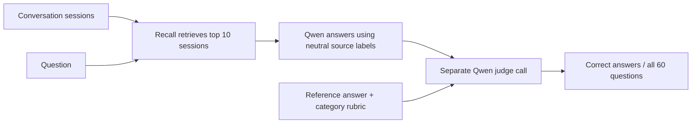

# LongMemEval: Recall and Hindsight

The completed blinded run answered **53/60 questions correctly (88.3%)**
using fresh Recall E5 hybrid retrieval and Qwen. Hindsight's published artifact
answered **54/60 (90.0%)** on those same question IDs, and **473/500 (94.6%)**
on the full benchmark.

These are different answer and judge models over a fixed diagnostic subset.
The one-question difference does not establish a system ranking.

Later full-corpus Recall experiments reached **457/500 (91.4%)**; their results
and failed successor trials are recorded in the
[improvement results](LONGMEMEVAL-IMPROVEMENT-RESULTS.md).

A later [saved-context replay](LONGMEMEVAL-CONTEXT-REPLAY-RESULTS.md) used the
same Qwen answerer and judge on both contexts. Recall scored 58/60 and
Hindsight's saved formatted context scored 56/60, with zero request errors.
Both passed five of the original seven cases. This diagnostic leaves the
published full score and existing acceptance gates unchanged.

An audit of the pinned Hindsight artifact also found exact original `answer_`
session IDs in 61 stored contexts (757 occurrences) and seven generated
answerer reasonings (eight occurrences). These prefixes provide an imperfect
relevance signal that Recall hides. The source trace supports a raw-response
prompt path, but historical wire prompts are unavailable; exposure for all
500 questions and any score effect are unmeasured. Hindsight's published
94.6% remains unchanged. The [validity review](LONGMEMEVAL-VALIDITY-REVIEW.md)
records the evidence and why a matched blinded rerun is needed for ranking.

| Run | Correct | Answer accuracy | Scope |
| --- | ---: | ---: | --- |
| Hindsight, published | 473/500 | 94.6% | Full LongMemEval-S |
| Hindsight, published subset | 54/60 | 90.0% | Exact fixed 60 IDs |
| Recall, fresh E5 + Qwen | 53/60 | 88.3% | Exact fixed 60 IDs, blinded |
| Recall, fresh keyword + Qwen | 440/500 | 88.0% | Full LongMemEval-S, blinded |

## How the score works

Reference answers and gold session labels are hidden from the answering model.
Answer and judge calls are separate. A failed request or malformed response
counts as incorrect.

## What the completed run shows

Fresh E5 retrieval found at least one marked relevant session in the top five
for **60/60** questions. All marked relevant sessions appeared in the top ten
for **59/60**. Retrieval success therefore exceeded final answer accuracy.

There were **five judged incorrect answers**, **one failed answer request**,
and **one malformed answer response**. Among successfully judged answers,
53/58 were correct (91.4%); this excludes failures and is a separate diagnostic,
not the primary score.

| Category | Recall correct / 10 | Hindsight correct / 10 |
| --- | ---: | ---: |
| Single-session user | 10 | 9 |
| Multi-session | 6 | 9 |
| Preferences | 9 | 6 |
| Temporal reasoning | 9 | 10 |
| Knowledge updates | 9 | 10 |
| Single-session assistant | 10 | 10 |

The multi-session misses included counting and date interpretation disagreements
with the reference even when all marked evidence was retrieved. Finding more
sessions alone would not resolve those cases.

The malformed response contained an answer but included unescaped newlines
inside its JSON reasoning string. The failed request terminated after about
301 seconds. Both remain failures under the fixed protocol; neither was
repaired or retried selectively.

## Configuration and limits

The cohort contains ten questions per category and no unanswerable questions.
It reuses a previously selected diagnostic cohort, fixed before fresh retrieval
and QA. It does not estimate full-benchmark accuracy.

Recall used `Xenova/multilingual-e5-small` and conversational hybrid-search
settings, indexing raw role/content sessions. Qwen `qwen3.8-flash-next` generated
and judged answers with temperature zero, reasoning disabled, and three
concurrent requests. The context budget was 180,000 characters across ten
sessions. One question required truncation; no selected question had ambiguous
duplicate-ID expansion. Retrieval took about 41.5 minutes, and QA took about
31.8 minutes. The QA calls reported 1,764,110 tokens; usage for the failed
request is unknown.

Hindsight used Gemini 3.1 Pro Preview for answers and Gemini 2.5 Flash Lite
for judging, with a fact-extraction retention path. The local Gemini attempt
could not reproduce that configuration because the answer account had depleted
credits and the old judge was unavailable to new users. These differences
prevent a matched system comparison.

This experiment tests isolated retrieval and answering over public conversations.
It does not test Recall's automatic capture, promotion, lifecycle delivery,
experimental temporal adapter, or Cloud.

Earlier answer trials exposed original source IDs whose `answer_` prefix
encoded relevance. Those trials are invalid as answer-score evidence.
The clean run uses neutral rank labels and dates. A rendered-prompt audit across
all 500 questions found zero original source-ID leaks, and a regression test
checks this boundary.

The broader blinded 500-question **keyword retrieval** baseline completed with
**440/500 correct (88.0%)**, including ten request failures and four incomplete
responses. It answered 23/30 unanswerable questions correctly. Multi-session
questions scored 100/133 and were its weakest category. The run took about
3.46 hours. It uses a different retrieval configuration from the E5 subset.

The completed raw results and
`benchmark/data/longmemeval-blinded-comparison-2026-10-19.json` are retained.
The [improvement experiments](LONGMEMEVAL-IMPROVEMENT-RESULTS.md) report subsequent
application fixes and candidate configurations separately.

## Evidence and reproduction

- [Published Hindsight artifact, pinned to the evaluated commit](https://github.com/vectorize-io/agent-memory-benchmark/blob/aef3702e0586a959c845cc2c61f10d5e8ff0f94a/outputs/longmemeval/hindsight/rag/s.json.gz).
- [Evaluation protocol and commands](../docs/longmemeval-evaluation.md).
- Local completed comparison: `benchmark/data/longmemeval-blinded-fixed60-comparison-2026-10-19.json`.
- Local raw QA report: `benchmark/data/longmemeval-qa-blinded-fresh-e5-60-2026-10-19.json`.
- Local retrieval validation: `benchmark/data/longmemeval-fresh-e5-fixed60-validation-2026-10-19.json`.
- Local provenance: `benchmark/data/longmemeval-blinded-run-manifest-2026-10-19.json`.

The source archives, input hashes, append-only case records, prompt audit and
original published artifact are retained under `benchmark/data/`. Final code
validation passed 1,194 tests with three skipped, strict benchmark TypeScript,
project typecheck, build, and docs checks.
