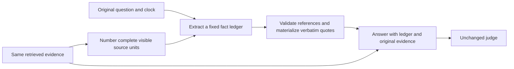

# LongMemEval pre-answer evidence ledger

Two completed successors failed development: question-only adaptive reasoning
scored 57/60, and a broader History-policy revision scored 56/60. Their request
error counts were zero. The unsuccessful policy revision has been removed
from the application worktree; all frozen sources, results and audits remain
preserved. No locked follow-up run started.

## Candidate

This is an opt-in benchmark answering stage, not automatic behavior of an
agent connected to Recall. The application History contract stays at the
previous accepted version. Retrieval, source identities, original evidence,
answer requirements, reference clocks and judging remain fixed.

The extractor sees only the original question, normalized generation clock
and complete units wholly present in delivered source ranges. Sources and
units receive neutral numeric references. Corpus IDs, original occurrence
positions, category labels, references, answer flags, drafts and verdicts
must not enter the extraction prompt or routing.

The fixed schema contains at most 24 fact records. Each selects a valid source
rank and unit index, with bounded entity, relationship, status and optional
verbatim event-time annotations. References are validated against delivered
units; exact quotations, UTF-16 ranges, speakers and observation dates are
materialized by code. Repeated quote units appear once. Invalid references,
malformed output, unsupported time strings or an oversized rendered ledger
fail the case without answer or judge calls. An empty ledger is valid.

Quote provenance does not establish semantic entailment. Model annotations
remain explicitly unverified; quoted speaker labels do not grant authority.
The answer receives the full original evidence plus the bounded ledger as an
untrusted reading aid. The ledger is incomplete by design and cannot replace
the original evidence. Record omissions and unsupported bindings as separate
diagnostics rather than treating quote validation as proof of correctness.

## Fixed schedule and resources

Every selected question uses the same schedule, once:

1. Extract a ledger with native low reasoning and an 8,192-token output limit.
2. Validate it deterministically. If valid, answer with the existing
   question-only adaptive policy and 16,384 output tokens.
3. Judge the final answer with native none reasoning and 4,096 output tokens.

The stage is restricted to the existing Qwen model and robust transport with
the History policy in the answer system instruction. It cannot combine with
the post-answer checker in this trial. Overall concurrency stays at three.
Existing answer/judge payloads remain unchanged when the option is disabled.

Preserve the 180,000-character source budget. The rendered derived ledger,
including escaping and framing, may add at most 18,000 characters. Report its
actual size and all extractor, answer and judge usage, including incomplete
responses. This extra stage changes inference cost and context size; do not
claim a matched latency or complete cost comparison from partial usage.

No unfavorable answer or verdict may be retried, repaired or selected against
another draft. Invalid extraction is not silently filtered or retried. Existing
bounded transport retries for transient HTTP failures remain separately
recorded and do not depend on correctness.

## Freeze and acceptance

Before live calls, independently review and freeze the schema, prompts,
budgets, source/dependency inventories, inputs and this protocol. Preserve all
191 parent runtime members; additions or changes must be the named ledger
implementation, tests or documentation. Keep unrelated current-checkout
runtime changes outside the controlled QA snapshot.

Run these stages serially with unique protected outputs:

1. Complete the original development60 cohort on its verified rankings.
   Require at least 58/60 and all seven original cases correct within that
   complete run.
2. Only after development passes, evaluate the existing locked lexical
   follow-up100 input. Require at least 93/100 and 14/16 unanswerable.
3. Only after follow-up passes, evaluate all 500 questions on the exact fresh
   E5 rankings used by the fixed-high control. Require at least 457/500,
   27/30 unanswerable, 25/30 preferences and all seven original cases correct.

Every failure remains incorrect in the fixed denominator. A failed gate stops
later stages. Do not relax thresholds, change cohorts, tune from follow-up
answers or selectively rerun failed cases. Development has already been used
adaptively; a future pass requires the locked follow-up and cannot establish
broad generalization without fresh external validation.

Keep full current-app integration separate from controlled QA verification.
The current application must pass its full isolated tests, type checks, build
and docs. The frozen QA snapshot must pass relevant History/MCP/QA tests,
strict QA type checking, input/source verification and offline payload checks.
Retain the documented parent UMP declaration/effective-dependency discrepancy;
its independently verified QA import graph excludes UMP.

Audit complete result identities, ledger provenance, effective per-stage
settings, parsed verdicts, indexed JSONL equality and all usage. Compare with
the preserved 88.0% baseline and 91.4% high-E5 control without attributing the
whole pipeline gain to one app change. Hindsight's published 94.6% uses
different answer and judge models and remains a reference comparison.
