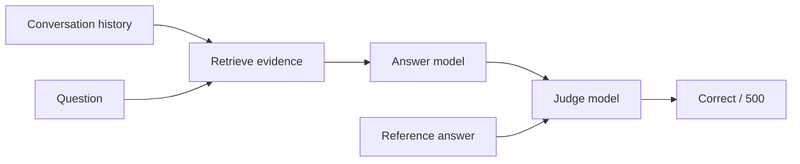

# LongMemEval-S

Recall's best experimental LongMemEval-S result is **474/500 (94.8%)**. It
comes from the second of two fresh runs of the same frozen configuration; the
first scored **470/500 (94.0%)**. The two runs average 472/500 (94.4%).

LongMemEval-S asks 500 questions about long conversation histories. Thirty of
them, with IDs ending in `_abs`, ask about things that were never mentioned, so
the correct answer is to decline. Each question is scored by retrieving
evidence, generating an answer and asking a separate judge to compare it with
the reference answer.



## Result

| | Run 1 (24 Oct) | Run 2 (25 Oct) | Earlier best (23 Oct) |
| --- | ---: | ---: | ---: |
| **Overall** | **470/500** | **474/500** | 472/500 |
| Answerable | 443/470 | 447/470 | 444/470 |
| Unanswerable (abstention) | 27/30 | 27/30 | 28/30 |
| Single-session user | 70/70 | 70/70 | 69/70 |
| Single-session assistant | 53/56 | 53/56 | 56/56 |
| Single-session preference | 28/30 | 29/30 | 28/30 |
| Multi-session | 121/133 | 120/133 | 118/133 |
| Temporal reasoning | 124/133 | 127/133 | 127/133 |
| Knowledge update | 74/78 | 75/78 | 74/78 |
| Final row errors | 0 | 0 | 0 |

Category rows include the unanswerable questions that belong to each category.
The earlier best used supplemental evidence: the top ten E5 sessions in full,
with deeper excerpts from the next ten in the remaining budget.

## Comparison with published results

| System | Score | Answer model | Judge model |
| --- | ---: | --- | --- |
| **Recall** (best of two runs) | **94.8%** (474/500) | Qwen `qwen3.8-flash-next` | Qwen `qwen3.8-flash-next` |
| Hindsight | 94.6% (473/500) | Gemini 3.1 Pro Preview | Gemini 2.5 Flash Lite |
| Supermemory | 85.9% | as published | as published |
| Zep | 71.2% | as published | as published |
| GPT-4o, full context | 60.2% | GPT-4o | as published |

Hindsight's score comes from the
[AMB result artifact](https://github.com/vectorize-io/agent-memory-benchmark/blob/aef3702e0586a959c845cc2c61f10d5e8ff0f94a/outputs/longmemeval/hindsight/rag/s.json.gz)
pinned at commit `aef3702e0586a959c845cc2c61f10d5e8ff0f94a`. The other three
scores come from Hindsight's published January 2026 comparison chart. None of
these systems was rerun locally, and they use different models, so this table
is not a head-to-head test. 474/500 exceeds Hindsight's published number by
one question.

An offline audit of Hindsight's stored contexts found original `answer_`
session IDs in 61 of them. That prefix can act as an imperfect relevance hint,
including in unanswerable variants. Recall hides original session IDs from the
answer model and shows only neutral rank labels and dates. The audit cannot
tell whether the IDs affected Hindsight's score; it is one more reason the
comparison is not matched.

We also gave Recall's saved contexts and Hindsight's saved contexts to the same
answer and judge models on the same 60 questions, with IDs hidden on both
sides. Recall's contexts scored 58/60 and Hindsight's 56/60. That small test
holds the models fixed but does not rerun Hindsight's full system.

## What we tried

Every change followed the same method. We wrote its protocol and pass rules
before making any model call, compared it against a fresh control run on the
same questions, and kept every result, including failures. When a change
passed on numbers, a separate reviewer checked each changed answer against the
source conversations. We never rejudged answers or retried them because they
were wrong.

These changes moved the full 500-question score, each run with Qwen answering
and judging:

| Full run | Change | Score |
| --- | --- | ---: |
| Baseline | Keyword retrieval, raw conversation excerpts | 440/500 (88.0%) |
| 2 | Highlighted evidence, History instructions, high reasoning | 446/500 (89.2%) |
| 3 | Semantic (E5) retrieval instead of keyword search | 457/500 (91.4%) |
| 4 | Separate check that rejects questions about things never mentioned | 454/500 (90.8%)¹ |
| 5 | Retry requests that fail before reaching the model | 464/500 (92.8%) |
| 6 | Retry timed-out answers at the same reasoning effort | 472/500 (94.4%) |
| 7 and 8 | Statement-focused evidence (this configuration), run twice | 470 and 474/500 |

¹ Sixteen calls failed during a model-server outage and count as wrong.
Unanswerable accuracy rose to 29/30, from 24/30 in run 3.

These ideas did not help and were dropped:

| Idea | What happened |
| --- | --- |
| Extract key quotes before answering (three variants) | 29/60, 57/60 and 57/60 against a 58/60 gate |
| Write two drafts and pick the better one | 59/60 in both arms, about three times the tokens |
| Majority vote over three answers | 57/60; the remaining misses were shared by every sample |
| Tell the answer prompt to reject false premises | Hurt answerable questions (57/60, then 53/60) |
| Shorter, more focused answers | Passed development, then missed 4 of 16 unanswerable questions |
| High reasoning for every question | 22/24 against 21/24, below the gain needed |
| High reasoning for date questions | 73/74 against 69/74, but some gains were not supported by the sources |
| Add more keyword-retrieved evidence | 93/100 against 94/100 for control |
| Re-review rejected answers with fresh evidence | Recovered four answers but lost two correct abstentions |
| Treat a count over several categories as mentioned if any category is | Let an unanswerable question through |
| Answer with GPT-5.6 on Azure instead of Qwen | 54/60 against 57/60, with one timeout |

## This configuration

This configuration uses statement-focused evidence. Each question receives the
same twenty E5-ranked sessions as the earlier best, plus up to twenty more
sessions from a keyword search on the question. All selected sessions are
rendered within one 180,000-character budget, at most 4,000 characters per
session, prioritizing complete statements by the speaker the question is
about. Turn boundaries come from the original structured messages, so quoted
`user:` text inside a message cannot pass for a new user turn. The renderer
adds no facts and resolves no dates. See [history evidence](../docs/history-evidence.md).

Everything else matches the earlier best: Qwen (`qwen3.8-flash-next`) answers
with adaptive reasoning and a 16,384-token limit, under the system History
instructions and minimal-answer policy; a separate low-effort premise check can
replace an answer with "not recorded"; and Qwen judges each answer against the
reference with reasoning off.

## How it was run

Both runs used the same frozen runtime from commit
`1ecd3a1ba269cf0aba785573337c6879adab8e49` with pinned dependencies,
Node 24.22.1 and Python 3.13.16. Each run covered all 500 questions in their
original order, in 167 blocks of at most three, with fresh answer, premise and
judge calls for every question. No answers or verdicts were reused from any
other run, and there were no correctness-based retries, rejudging or exclusions.
The existing timeout and incomplete-response recovery applied in both runs; it
fired twice per run. Pinned inputs:

| Input | SHA-256 |
| --- | --- |
| Prepared benchmark input | `169e909e5e514a8376871fb3351c6597e90bfdf696f6d7206ec33d91dd9c02f4` |
| Exact E5 rankings | `3202a46e13795ee463c2dee91c7831c03f71ed6ee7668c19f7092675d6b1234d` |
| Structured turn manifest | `1a3f7baa93c76512f04f2ef0423d2cbf2f521ded59f6c18af86415b68876e1f5` |
| Earlier-best baseline report | `9cba4555cad8031eec9e404d96ae4f7065c302cbacfa8a87f1232c0b9e0105f0` |

Answer generation never sees original session IDs, reference answers,
categories or abstention labels. Each run used about 35.4 million observed
tokens and took roughly eight hours.

## Reproducing

The raw dataset, prepared inputs and full model outputs stay in
`benchmark/data/`, which is not committed. Prepare them first:

```sh
# Freeze the public corpus and the AMB answer and judge prompts.
uv run --no-project python benchmark/prepare-longmemeval-qa.py \
  --sources <AMB checkout at aef3702> \
  --out benchmark/data/longmemeval-amb-input.json

# Rebuild trusted turn boundaries from the original structured messages.
node --import tsx benchmark/longmemeval-source-turns.ts \
  --raw benchmark/data/longmemeval_s_cleaned.json \
  --prepared benchmark/data/longmemeval-amb-input.json \
  --out benchmark/data/longmemeval-source-turns.json
```

The full run is driven by `benchmark/run-longmemeval-statement-full500.py`.
It checks every input, the runtime and its protocol against pinned hashes, so
use a checkout of commit `5f217e7`, which holds the frozen protocol file.
Without `--live` it only prepares; with `--live` it makes the model calls
through the DGX router:

```sh
uv run --no-project python benchmark/run-longmemeval-statement-full500.py \
  --source-root <frozen runtime> --data-dir benchmark/data \
  --node <node 24.22.1> --out-dir <new output dir> \
  --protocol benchmark/LONGMEMEVAL-STATEMENT-FULL500-PROTOCOL.md \
  --source-turns benchmark/data/longmemeval-source-turns.json \
  --pilot-inventory <pilot inventory.json> --live
```

For a single ad hoc run, `benchmark/longmemeval-qa.ts` runs the answer harness
directly with the same settings. Without `--provider` it prepares and makes no
model calls:

```sh
dgx run -- node --import tsx benchmark/longmemeval-qa.ts \
  --input benchmark/data/longmemeval-amb-input.json \
  --provider qwen-local --retrieval cached \
  --rankings benchmark/data/<E5 rankings>.json \
  --evidence statements --source-turns benchmark/data/longmemeval-source-turns.json \
  --top-k 20 --context-chars 180000 \
  --evidence-policy system --answer-policy minimal --answer-check premise \
  --reasoning-effort adaptive --max-output-tokens 16384 \
  --request-mode robust --answer-recovery longer-timeout-transport \
  --concurrency 3 --out benchmark/data/<new report>.json
```

The [evaluation guide](../docs/longmemeval-evaluation.md) lists the harness
flags, model settings and output files.

## How to read the result

- **Run-to-run variation is large.** Across the earlier best and both runs of
  this configuration, 454 questions were right every time, 35 changed between
  runs and 11 were wrong every time. A difference of a few questions between
  runs is within this variation.
- **The comparison with other systems is not head-to-head.** Different answer
  and judge models are used, and the other systems were not rerun.
- **The public dataset has been used repeatedly during development.** Fresh
  calls do not make these questions unseen.
- **Some correct-judged answers still contain errors.** A source review of the
  100-question pilot for this configuration found accepted answers that
  misidentify a person or infer unstated facts, and misses that drop an ongoing
  activity or prefer an assistant's estimate over the user's own figure.
- **The judge differs from the official evaluator.** The AMB judge uses the
  ordinary category prompts for unanswerable questions, while the official
  LongMemEval evaluator has a dedicated prompt for them. One reference answer
  (`dd2973ad`) contains an error acknowledged upstream; it was scored as
  published.
- **This is a benchmark harness result.** It indexes raw conversation sessions
  per question. It does not test automatic capture, memory promotion,
  instruction injection, the experimental temporal store or Recall Cloud.

Older protocols and per-experiment reports remain in the git history of this
folder.
