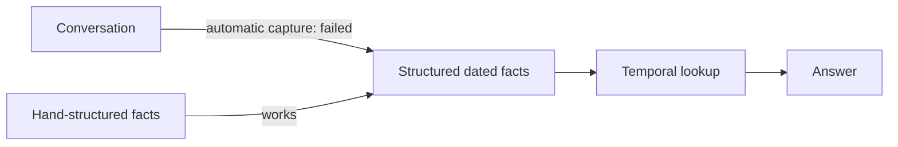

# Temporal memory experiments

Recall's temporal store answers "what was true at date X" questions well when
it receives clean, structured facts, using far less context than other
representations. Turning ordinary conversation into those facts automatically
did not work well enough. **The temporal store stays experimental, and
automatic capture stays disabled.** The feature itself is described in
[temporal memory](../docs/temporal-memory.md).



## Structured facts: the store works

All arms received the same hand-structured source facts and the same answer
model (Qwen `qwen3.8-flash-next`, reasoning off, 512 output tokens).

| Experiment | Existing compiler | Temporal store | Full history | Scoped history |
| --- | ---: | ---: | ---: | ---: |
| Synthetic pilot (25 questions) | 21/25 | **23/25** | 22/25 | — |
| Expanded (80 questions × 3 repeats) | 207/240 | **225/240 (93.8%)** | 215/240 | 207/240 |

The temporal context was 76.6% smaller than the compiler's in the pilot and
80.6% smaller in the expanded run. In the expanded run every bootstrap
interval for the temporal gain includes zero, and the questions come from 40
generated worlds built on ten templates, so these are development results.
Exact source citations did not improve.

An integration rehearsal then checked that temporal rows do not disturb
ordinary memory. Across 125 worlds covering every memory type, source, scope
and status, the compiler made **1,500 comparisons with zero selection
differences**.

## Automatic capture: it does not work yet

The same rehearsal asked the model to extract dated facts from conversation:

| Capture measure | Result |
| --- | ---: |
| Temporal sources with every exact field | 11/18 (61.1%) |
| Extracted timeline queries, including empty results | 35/45 (77.8%) |
| Queries requiring supported evidence | 12/21 (57.1%) |

Later rounds tried to fix capture and tested it on 434 public LongMemEval-S
questions, each against a raw-evidence control with the same budget (shared
raw) and one with the full budget (full raw):

| Round | Change | Temporal | Shared raw | Full raw | Finding |
| --- | --- | ---: | ---: | ---: | --- |
| v2 language adapter | Stable keys, quote validation, natural-question routing | 165/434 | 165/434 | 182/434 | Only 1/434 questions received any temporal facts. The small synthetic holdout gain came from value casing. |
| Bug diagnosis | Offline probes of the v2 run | — | — | — | Nothing was stored for 392 of 433 questions; 1,007 rejections proposed the subject "user". |
| v3 validator | Fixed grounding, speaker spans, date association | 165/434 | 165/434 | 182/434 | Replay of saved proposals; no gain. |
| UMP capture pilot | Capture through UMP drafts, 24 synthetic worlds | 27/34 | — | — | Matched v3 scored 29/34; precision 80% against 100%, with four future plans stored as facts. |
| v4 (UMP 1.0.2) | Fresh capture, query, answer and judge calls | 168/434 | 168/434 | 179/434 | One augmentation, no gain; request or schema failures affected 51.15% of cases. |

These 434 questions come from a public corpus that had already been used, so
they are not an independent holdout. Retrieval was lexical with embeddings
off, and one model both answered and judged.

APEX-MEM was not compared. Its published results use a different protocol,
and no runnable implementation was found.

## Running the experiments

Each harness uses disposable databases. Without `--provider`, it makes no
model calls and only checks the setup. Model runs go through the DGX router
with local Qwen; run them one at a time to stay within the request limit. The
public-question runs need `benchmark/data/longmemeval_s_cleaned.json`, which
is not committed.

| Harness | What it measures |
| --- | --- |
| `temporal.ts` | Synthetic pilot: compiler, temporal store and full history |
| `temporal-expanded.ts` | Expanded synthetic comparison with repeats and scoped history |
| `temporal-intake.ts` | Fixed-schema extraction and question parsing |
| `temporal-preservation.ts` | Ordinary-memory coexistence matrix (no model calls) |
| `temporal-categories.ts` | Capture across memory types and source-language boundaries |
| `temporal-public.ts` | Sampled public conversations |
| `temporal-v2.ts` | v2 language adapter, development and holdout splits |
| `temporal-real.ts` | 434 public questions with the v2 adapter |
| `temporal-real-v4.ts` | 434 public questions with v4 capture |
| `temporal-ump.ts`, `temporal-ump-v2.ts` | UMP capture against matched v3 capture |

```sh
node --import tsx benchmark/temporal.ts --out /tmp/recall-temporal-smoke.json
dgx run -- node --import tsx benchmark/temporal-expanded.ts \
  --provider qwen-local --qwen-reasoning none --repeats 3 \
  --out benchmark/data/temporal-expanded.json
dgx run -- node --import tsx benchmark/temporal-v2.ts \
  --provider qwen-local --split holdout --out /tmp/recall-v2-holdout.json
node --import tsx benchmark/temporal-real.ts --prepare --out /tmp/recall-real-plan.json
dgx run -- node --import tsx benchmark/temporal-ump.ts \
  --provider qwen-local --out /tmp/recall-ump-fresh.json
```

Every harness refuses to overwrite an existing output. `temporal-real.ts`,
`temporal-real-v4.ts` and the UMP harnesses record a hash of their frozen
protocol, so reproducing a recorded run means checking out the commit that
produced it. Older protocols and per-run reports remain in the git history of
this folder.
