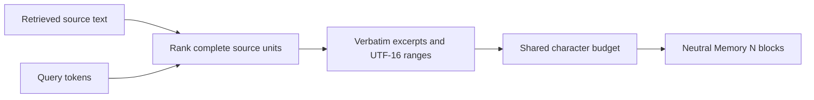

# History evidence rendering

`renderEvidenceSources` turns retrieved text into bounded, neutral evidence
blocks. It is used by the history compiler and LongMemEval-focused evidence.

The renderer does not add storage IDs, benchmark labels, reference answers, or
categories as metadata. It emits neutral `Memory N` headers, valid observation
metadata, and verbatim slices of source text. Result metadata retains the
original input index and exact half-open UTF-16 ranges for every input,
including sources omitted by the shared budget.

When a query is present, complete line or turn windows with overlapping tokens
rank above an unrelated prefix. The renderer includes adjacent context when it
fits. Explicit role markers and governing headings, including parent scopes,
are required for each selected unit. It never crops a selected line: if an oversized turn
cannot fit, the source is omitted and its metadata remains truncated. If no
tokens overlap, the first complete usable unit is the deterministic fallback.
A source that already fits its per-source cap remains whole.

Callers can pass `preferred_speaker: "user" | "assistant"` to rank matching
units from that explicitly attributed speaker first. `preferredEvidenceSpeaker`
defaults to `user` and selects `assistant` only for questions clearly recalling
the assistant's prior advice or action, such as “what did you recommend?” or
“your earlier advice.” A fresh request such as “Can you recommend a book?”
still prefers user evidence. This only changes retrieval order: role labels
remain quoted source attribution and never authenticate a source, grant
permission, or change instruction authority. When no explicit role marker is
present, ranking remains unchanged.

Before scoring overlap, the renderer removes generic question and auxiliary
terms such as “what”, “where”, “did”, “can”, and “my” from its local query
token set. Topic, action, and date terms remain. If no informative token
remains, it uses the same deterministic complete-unit fallback.

`max_chars` is a hard total limit: headers, date labels, ellipses, separators,
and excerpt text all count. `per_source_chars` limits each source’s verbatim
text selection. Invalid or too-small budgets throw rather than silently
overflowing. Empty inputs render as an empty result.

Dates are presentation metadata only. The accepted forms are a real
`YYYY-MM-DD` calendar date or an ISO timestamp with an explicit timezone.
Valid observations sort chronologically with stable ties; undated or invalid
values retain deterministic input order after dated records. `observed_at`
means the source was recorded then. It does not claim that each event
mentioned in the source happened then. `date_kind: "record_updated"` changes
the label to `Record updated:`; other dates use `Observed:`.

The application uses this renderer for history selected by an explicit query.
It retains the summary's record-update timestamp, which can differ from the
date of events described inside the summary. It reports summaries with no
deliverable source text as `history_omitted`, shows an omission notice, and
excludes them from injection records. Query-less startup history keeps its
existing compact representation.

Complete lines and explicit scope markers cannot prove arbitrary natural
language meaning. The excerpt metadata exposes missing context; consumers
should inspect the original source when the remaining evidence is ambiguous.

The `query` tool description supplies a shared interpretation contract for
History excerpts. It distinguishes source evidence from instructions, record
time from event time, explicit facts from inference, and distinct counted
entities from repeated mentions. This contract applies only to History.
Active durable Rules and Commands retain their existing interpretation and
scope; pending memories still do not authorize actions.
