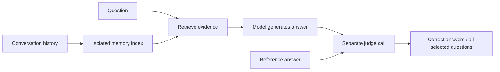

# LongMemEval answer evaluation

LongMemEval-S contains 500 questions over long conversation histories. The local
cleaned corpus includes 30 unanswerable question IDs ending in `_abs`; their
`question_type` values still use the six ordinary categories.



Retrieval hit rates measure whether a relevant session appears in the search
results. Answer accuracy additionally tests whether the selected text contains
the needed evidence, the model reasons correctly, and it declines unanswerable
questions. Finding one relevant session does not establish complete evidence.

## Published Hindsight reference

The [AMB result artifact](https://github.com/vectorize-io/agent-memory-benchmark/blob/aef3702e0586a959c845cc2c61f10d5e8ff0f94a/outputs/longmemeval/hindsight/rag/s.json.gz)
records **473/500 correct, or 94.6%**, with Gemini 3.1 Pro Preview generating
answers and Gemini 2.5 Flash Lite judging them. It reports 11,303 ingested
documents, approximately 8.36 hours of ingestion, mean retrieval latency of
674.9 ms, and mean answer context of 43,624.5 tokens.

This is a published result from Hindsight's maintainers. It is not a fresh
local reproduction of their system. The dataset, prompt templates, model IDs,
and result artifact are pinned to the linked AMB commit.

An offline source-and-artifact audit found 757 exact original `answer_`
session-ID occurrences in 61 stored contexts, and eight occurrences in seven
generated answerer reasonings. Six of those reasoning cases have no such ID
in their stored formatted context. The pinned prompt builder can serialize a
raw response that is not preserved in the result artifact. Historical wire
prompts are unavailable, so all-500 exposure and any accuracy effect remain
unverified. The prefix is an imperfect relevance signal, including in
abstention variants. The published score remains unchanged; original-ID
visibility is an additional obstacle to a matched comparison with blinded
Recall. The [validity review](../benchmark/LONGMEMEVAL-VALIDITY-REVIEW.md)
preserves the source trace, counts and limits.

The separately specified
[saved-context diagnostic](../benchmark/LONGMEMEVAL-CONTEXT-REPLAY-PROTOCOL.md)
holds the answerer and judge fixed across Recall's and Hindsight's saved
contexts for the original sixty development questions. It preserves complete
text under a shared ceiling, so evidence amount remains a difference alongside
representation. It does not reproduce the missing historical raw prompt,
undo upstream ID visibility, or advance a rejected candidate.

`buildContextReplayInput` in `benchmark/longmemeval-context-replay-input.ts`
prepares that separate input. The builder and runner jointly verify the
original sixty identities,
Recall's saved answer-prompt hashes, source metadata, complete-context bounds,
identifier blinding and answer/judge templates before credential setup.
The runner defaults to an offline preparation report:

```sh
node --import tsx benchmark/longmemeval-context-replay.ts \
  --input benchmark/data/longmemeval-context-replay-input-2026-10-21.json \
  --out benchmark/data/longmemeval-context-replay-prepared.json
```

Live execution additionally requires `--live` and `dgx run --`, using the
reviewed frozen source and its private Node22 dependencies. It creates 120
counterbalanced side tasks with at most three concurrent calls. Each side has
a fixed denominator of sixty; failures count as incorrect. All new answers,
judge calls, settings and hashes remain recorded. Output paths cannot be
reused, including after a partial run.

The [completed replay](../benchmark/LONGMEMEVAL-CONTEXT-REPLAY-RESULTS.md)
scored **58/60 for Recall's saved contexts and 56/60 for Hindsight's**, with
zero request errors. Both sides passed five of the seven original cases.
All 240 calls completed on their first attempt, with 5,248,179 observed tokens
and no unknown usage. Independent audit verified every context, prompt,
verdict, inference setting and frozen dependency. One launch-provenance
filename was mislabeled through variable shadowing; its exact intended
artifact digest and source checks were verified without rewriting the record.
This descriptive diagnostic leaves the earlier rejected candidates, all
acceptance gates and both published full scores unchanged.

The separate
[paired inference protocol](../benchmark/LONGMEMEVAL-INFERENCE-COMPARISON-PROTOCOL.md)
defines one fresh control against a two-draft/arbitration answering treatment.
Both arms use the same complete Recall context. A preselected seventeen-case
grounding review remains blinded until its ratings are locked; accuracy alone
cannot advance the treatment. Its runner defaults to offline preparation:

```sh
node --import tsx benchmark/longmemeval-inference-trial.ts \
  --input benchmark/data/longmemeval-context-replay-input-2026-10-21.json \
  --selection benchmark/data/longmemeval-inference-comparison-grounding-selection-2026-10-21.json \
  --out benchmark/data/longmemeval-inference-comparison-prepared.json
```

Live execution requires `--live` through the authenticated DGX router and the
reviewed private Node22 source copy. The runner reserves result, task JSONL,
per-call JSONL and progress paths before credential setup. Each physical
stage call is journaled before starting its successor. Injected test calls
are explicitly invalid as benchmark evidence. Post-trial packets and locked
ratings use `buildGroundingPackets`, `validateGroundingRatings` and
`aggregateLockedGrounding` from `longmemeval-inference-grounding.ts`;
the protocol specifies the external commitment and unmasking order.

The [completed paired trial](../benchmark/LONGMEMEVAL-INFERENCE-COMPARISON-RESULTS.md)
scored **59/60 with all seven original cases correct in both arms**. All
360 calls succeeded on their first attempt. There were no paired gains or
losses, while comparison used 6,842,109 tokens versus 2,284,332 for control.
The locked seventeen-case source review found 36 unsupported/contradicted
propositions across seven comparison answers, versus 29 across six control
answers, with complete final-answer coverage in both. Ten unresolved claims
and one segmentation flag additionally leave grounding unproven. This sample
does not establish general grounding rates. The treatment fails advancement;
no follow-up100 or full500 started, and no earlier result was promoted.

The separate [minimal-answer policy trial](../benchmark/LONGMEMEVAL-MINIMAL-ANSWER-PROTOCOL.md)
compared two fresh one-pass arms with unchanged evidence and model settings.
The policy arm scored **59/60** with all original seven cases correct and zero
errors. The control arm scored 58/60 because one control answer for
`0a995998` timed out and counts as incorrect. Both arms missed
`gpt4_59c863d7`, so the single paired gain comes from the timeout rather than
the policy. The policy shortened answers by about a fifth, but its longer
instructions raised observed total tokens to 2,293,525 across 120 calls, versus
2,241,947 across the control's 119 completed calls. The control also has one
failed call with unknown usage, which makes the strict lower-token requirement
ineligible, and the policy still used more tokens after mean imputation for
the missing control calls. Because every requirement must pass, the blinded
grounding review was not dispatched; its outcome could not change the
decision. The policy is rejected, with no follow-up100 or full500 started.
The [decision record](../benchmark/data/longmemeval-minimal-answer-final-decision-2026-10-21.json)
binds the report, terminal record and completed audit hashes.

`benchmark/longmemeval-qa.ts` now accepts `--answer-policy minimal`, which
appends `MINIMAL_ANSWER_POLICY` to the system History contract. It requires
`--evidence-policy system`, rejects evidence ledgers, grounded checks and the
Azure answer path, and records the instruction hashes under
`answer_instructions` in each report. The default remains `history`.
Through this flag the configuration passed fresh development60 at 58/60 but
failed locked follow-up100 on unanswerable questions (12/16 against 14/16);
see the [gates protocol](../benchmark/LONGMEMEVAL-MINIMAL-SUPPLEMENTAL-GATES-PROTOCOL.md).
The flag also accepts `premise` and `minimal-premise`, which append
`PREMISE_CHECK_POLICY` and record `premise_sha256`. In development both premise
versions dropped development60 below 58/60, so neither ran on locked cohorts;
see the [premise-check decision](../benchmark/data/longmemeval-premise-check-decision-2026-10-21.json).

`--answer-check premise` adds one separate low-reasoning call after each
successful answer. It sees only the question, clock and evidence, never the
draft, and replaces the answer with a fixed "not recorded" statement only on
an explicit `false` verdict; check failures keep the draft. Rows record
`draft_answer`, `premise_call`, `premise_recorded` and `premise_override`.
`benchmark/longmemeval-premise-replay.ts` reruns only the check on a saved
report for development comparisons. Its locked development60 run scored
57/60 with zero overrides; see the
[gates protocol](../benchmark/LONGMEMEVAL-PREMISE-CHECK-GATES-PROTOCOL.md).

Its runner prepares offline by default:

```sh
node --import tsx benchmark/longmemeval-minimal-policy-trial.ts \
  --input benchmark/data/longmemeval-context-replay-input-2026-10-21.json \
  --selection benchmark/data/longmemeval-minimal-answer-grounding-selection-2026-10-21.json \
  --out benchmark/data/longmemeval-minimal-answer-prepared-NEW.json
```

Native execution requires a new reviewed source freeze, explicit `--live`
through the authenticated DGX router, private Node22 dependencies and the
unchanged staged numerical gates.

Hindsight extracts facts and entities during retention, then combines semantic,
keyword, graph and temporal retrieval with reranking. Recall's existing
conversation benchmark indexes raw sessions instead. These different retention
paths must remain visible in any comparison.

## Local harness

The [paired answer-effort pilot](../benchmark/LONGMEMEVAL-EFFORT-PILOT-PROTOCOL.md)
tests explicit high initial answer reasoning against the adaptive policy on
24 hash-selected questions that previously used low effort. Supplemental
evidence permits `--reasoning-effort high` as an experimental alternative to
`adaptive`, retaining the 16,384-token budget and all other input and transport
requirements. Defaults are unchanged. This pilot is exploratory, uses fresh
control answers, and cannot replace a full-corpus result.

That pilot finished at **21/24 for control and 22/24 for high reasoning**,
missing its predeclared net-gain threshold. A separate
[abstention-recovery replay](../benchmark/LONGMEMEVAL-ABSTENTION-RECOVERY-PROTOCOL.md)
reviewed all 29 historical negative-premise cases with a limited keyword source
refresh. Its **474/500 mixed saved-answer score** includes 471 reused historical
answers and two lost abstentions. It also fails advancement and is not a fresh
full500 result. The public **472/500** remains unchanged. Both reports retain
source-grounding caveats and fixed judge verdicts.

The fresh paired [scope-recovery trial](../benchmark/LONGMEMEVAL-SCOPE-RECOVERY-PROTOCOL.md)
finished **27/29 in both arms**, with no paired accuracy difference. Each arm
produced a **475/500 mixed replay**, reusing 471 historical answers and losing
one historically correct abstention. Scope instructions cleaned up one
biography answer but did not prevent substituted-role answers. Both arms fail
advancement; neither changes the public score.

The [selective temporal-effort experiment](../benchmark/LONGMEMEVAL-TEMPORAL-EFFORT-PROTOCOL.md)
completed **69/74 for fresh control and 73/74 for high effort**, with four judged
gains, no paired losses and all seven abstentions correct in each arm. It passed
the numerical screen but did not establish source support for every gain:
accepted answers still assert unresolved trip ordering and connect bedtime to
an appointment from a different week. All fixed scores are retained. This
configuration does not advance, and application defaults and public score
claims remain unchanged.

The [temporal event investigation](../benchmark/LONGMEMEVAL-TEMPORAL-EVENTS-NOTES.md)
separates event identity, action status, source time and event time. Its first
offline helper keeps discovered prose mentions unresolved and only interprets
complete supported date expressions, retaining multiple calendar readings.
It cannot establish event occurrence or join unrelated facts. This is a
prototype for source inspection, with no changes to answer generation or scores.

An [offline additive-retrieval diagnostic](../benchmark/LONGMEMEVAL-ADDITIVE-RETRIEVAL-NOTES.md)
retains all twenty E5 sources and adds up to twenty distinct keyword results.
Marked-source coverage rises from 463/470 to 470/470 across answerable cases,
but query-focused excerpts can still omit the actual user statements. The
separate renderer prototype reserves preferred-speaker statements within an
additional bounded context budget. Neither source coverage nor code tests
establish an answer-accuracy gain, and this prototype does not alter the frozen
temporal experiment or the ordinary renderer default.

The [fresh paired additive-evidence protocol](../benchmark/LONGMEMEVAL-ADDITIVE-TRIAL-PROTOCOL.md)
defines the next answer-quality test: all thirty abstention questions plus
seventy hash-selected answerable questions. Both arms retain adaptive reasoning
and the same premise check. The treatment appends evidence to the exact control
prefix; advancement requires a net gain, no paired abstention loss and source
review of every changed outcome.

`--evidence additive` enables this benchmark-only treatment with cached exact
occurrences, top twenty sources and the fixed 180,000-character base budget.
Live execution requires system evidence policy, minimal answers, the premise
check, adaptive reasoning with 16,384 output tokens, robust transport and
longer-timeout recovery. It rejects Azure answers, ledgers and multiple samples.
Reports record the additional 80,000-character budget, lexical selection limits,
code hashes and per-row `additive_diagnostics`. `retrieval_ms` includes its fresh
keyword search and evidence rendering. Injected additive test calls produce
`comparison_valid: false`; no test output qualifies as live evidence.

The first additive attempt was interrupted after three completed pairs, all
correct in both arms. No rows were recorded for the next treatment block,
and its in-flight usage is unknown. Its stale running checkpoint is preserved
with a separate interruption receipt. The operational restart repeated all one
hundred cases with fresh calls and identical settings in a persistent session.
It scored **94/100 control and 93/100 additive**, with two recorded gains and
three losses, and used 41.02% more tokens. One recorded gain reflects judge
variation between nearly identical supported abstentions. The treatment fails
advancement; all scores remain fixed.

The [statement-evidence trial](../benchmark/LONGMEMEVAL-STATEMENT-TRIAL-PROTOCOL.md)
uses the same cohort with fresh answers in both arms. `--evidence statements`
renders the original twenty and up to twenty lexical sources together within
180,000 characters, prioritizing complete preferred-speaker statements. It
requires `--source-turns` with a manifest rebuilt from the original structured
role/content messages, bound to raw and prepared input hashes. QA verifies
source text, identity, date and exact turn spans before credentials or model
calls. Nested role-like text cannot create a new trusted turn. Injected calls
remain invalid as benchmark evidence. This is an exploratory combined treatment
whose numerical and source-review gates precede any fresh full500 evaluation.

That trial finished **93/100 control versus 95/100 statements**, with both arms
at 28/30 abstentions and no paired abstention loss. All 600 calls succeeded.
The numerical gate passed, but independent source review did not clear
advancement: accepted answers include a wrong person identity and an unsupported
harvest claim, while losses discard an ongoing yoga class and replace a user's
fare quote with an assistant estimate. The candidate does not advance to
full500. Its 95/100 pilot score cannot replace the public 472/500 result.

The separate [category-union premise diagnostic](../benchmark/LONGMEMEVAL-PREMISE-UNION-PROTOCOL.md)
keeps the canonical supplemental contexts and makes two fresh premise calls per
question: the original policy and an opt-in clarification for aggregate counts
over generic categories. Named subjects and explicit co-occurrence constraints
remain required. `--premise-policy category-union` is available only with
`--answer-check premise --evidence supplemental`; omitting it preserves the
original prompt. The check-only runner makes no answer or judge calls and emits
no answer-accuracy score. Source review and a separately frozen fresh full run
remain necessary before changing public numbers or publishing the requested
release.

The category-union diagnostic completed all 200 calls without errors but failed
its abstention safety gate. It does not advance. Edi subsequently requested a
separate [exploratory full500 run of the original statement candidate](../benchmark/LONGMEMEVAL-STATEMENT-FULL500-PROTOCOL.md).
That new request does not clear either failed gate or remove the source-review
findings. It uses fresh answers for all 500 cases, unchanged pilot settings and
the original premise policy. The first full run finished at **470/500 (94.0%)**,
including 27/30 abstentions, with no final row errors and two recorded answer
recoveries. It missed the numerical target. Edi then requested one replication
with exactly the same frozen configuration and fresh calls for all 500 cases.
Both results will be retained and reported together; the repeat and publication
decision remain pending. The public best stays 472/500 (94.4%).

`benchmark/prepare-longmemeval-qa.py` freezes the public corpus and extracts
literal AMB answer and category-specific judge prompts through Python AST
inspection. It does not import or execute the external Python implementation.
The serialized source text contains roles and content; `has_answer` flags are
excluded. Reference answers remain separate from the generation prompt.

Original session IDs are also hidden from generation: the public corpus uses
`answer_...` identifiers associated with answer sources. The prefix is an
imperfect relevance signal rather than a reliable gold label, including in
abstention variants. Exposing those IDs would reveal that signal. Source headers use
only neutral retrieval-rank labels and dates. Original IDs and occurrence
positions remain in scorer diagnostics. This header change is an explicit
deviation from the AMB source-identity presentation.

The early resource trials exposed original IDs and are invalid as answer
accuracy evidence. Their artifacts are marked `comparison_valid: false`.
Their answer percentages must not be used in comparisons. Retrieval-only
measurements remain usable because indexed source text excluded the IDs.

The [completed blinded 60-question run](../benchmark/LONGMEMEVAL-HINDSIGHT-RESULTS.md)
scored 53/60 with fresh E5 retrieval and Qwen. Hindsight's published answers
scored 54/60 on the same IDs. These use different models and a diagnostic subset;
they do not establish matched system performance.

The completed full lexical baseline scored 440/500 (88.0%). The frozen
highlighted-evidence, History-policy, robust-request and high-reasoning
candidate scored 446/500 (89.2%), with unanswerable accuracy improving from
23/30 to 27/30. Multi-session answers improved, while preferences regressed
from 25/30 to 19/30. This combined pipeline result does not isolate a retrieval
gain or establish a broad accuracy improvement. Its separately selected
100-question validation scored 90/100 versus 88/100 baseline; those same
questions scored 88/100 when repeated within the full candidate run.

Fresh full-corpus E5 retrieval completed at 99.4% relevant-session hit rate
at top 10, with all 500 exact source occurrence mappings and fingerprints
verified. That is a retrieval score. Its full answer run scored 457/500
(91.4%), with six failed calls, 24/30 unanswerable answers and 22/30 preferences.
Six of the seven original development failures passed. Independent offline
review verified all evidence and prompt hashes, successful verdicts, result
accounting and frozen provenance. The remaining regressions keep the
improvement goal open. The [improvement results](../benchmark/LONGMEMEVAL-IMPROVEMENT-RESULTS.md)
retain regressions, failed calls, resource limits and snapshot-restoration
provenance.

An independent scorer-only audit found every marked answer turn fully visible
for 452/470 answerable questions with fresh E5, versus 431/470 with baseline
lexical retrieval. Neither representation clipped a retrieved marked turn.
The difference therefore reflects retrieved source coverage; it does not prove
an answer-accuracy or highlighting gain. Unmarked context can still matter.

`benchmark/longmemeval-qa.ts` supports two explicit evidence sources:

| Mode | Evidence source | Interpretation |
| --- | --- | --- |
| `lexical` | Fresh isolated index using Recall's production FTS implementation with OR queries | Keyword retrieval baseline over raw conversations |
| `cached` | Supplied session rankings, with their own provenance | Expanded reconstruction for the selected subset |

Candidate experiments additionally support `--evidence focused` and
`--request-mode robust`. Defaults remain `prefix` evidence and `standard`
requests. Focused evidence uses the application's
[verbatim history renderer](history-evidence.md), with a 4,000-character
per-source ceiling, complete units, explicit gaps and recorded evidence-use
guidance. Robust Qwen requests use strict JSON schemas and a native HTTP
transport bounded by the 600-second caller deadline. Neither option repairs
an answer or retries an unfavorable verdict.

`--answer-check grounded` adds one fixed, gold-blind answer verification call
for every successfully drafted answer. It uses the same evidence and clock,
then sends only the final answer to the usual judge. Drafts, verification
calls, failures and usage remain in the report. The default is `none`.
This additional answering stage is a benchmark configuration, separate from
ordinary Recall retrieval and lifecycle behavior.

`--reasoning-effort` and `--max-output-tokens` explicitly override Qwen answer
inference. Defaults remain `none` and 4,096 tokens. These overrides do not
change the judge's reasoning or token budget. Reasoning-mode experiments must
remain separate from the original baseline; reported usage includes incomplete
responses when the provider supplies it.

The opt-in follow-up `--reasoning-effort adaptive` requires `qwen-local` and
an explicit positive `--max-output-tokens` value. It selects native `high` for
recognized English enumeration phrases in the original question, and `low`
otherwise. Source text, question categories, IDs, reference answers and verdicts
are not routing inputs. The answering and optional review calls receive only
question metadata; judges stay at `none` and 4,096 tokens. Each Qwen call records
its actual reasoning mode and output limit in `request_config`, including
failures. Missing question metadata sends no request.

This experimental routing policy addresses observed high-reasoning output-budget
exhaustion. Its seven-case diagnostic passed, but the complete development run
scored 57/60 with zero request errors and only six of the seven original cases
correct. It failed both development gates; no adaptive follow-up or full-corpus
run started. It changes no previous frozen run or ordinary agent connected to Recall.
Its separate locked follow-up cohort excludes
the original development and validation IDs but comes from the same previously
evaluated public corpus.

`--evidence-ledger quoted` is a separate opt-in pre-answer stage. It requires
Qwen, robust requests, system History policy, explicit adaptive/16,384 answer
settings and concurrency at most three. It cannot combine with the grounded
post-answer checker. A low/8,192 extractor selects neutral references to
complete visible source turns. Code validates those references and materializes
verbatim quotations and UTF-16 ranges; semantic annotations remain unverified.
Malformed, invalid or oversized extraction counts as an incorrect case without
answer or judge calls. Empty extraction remains valid.

The final answer retains all original evidence and adds at most 18,000 rendered
ledger characters. Judges remain none/4,096. Reports preserve extractor usage,
effective settings, ledger size and final answer-prompt hashes; the summary
includes source and derived context separately. Disabled request payloads match
the earlier frozen implementation. Full current-app integration passed 1,293
tests with three skipped, and the controlled QA snapshot passed 98 relevant
tests and strict type checking. Independent freeze review passed, but the
development run failed at 29/60 with 31 extraction-validation failures. It did
not advance. The 29 answered cases were all judged correct; that selected
subgroup is not a pipeline score or evidence of generalization. The
[ledger protocol](../benchmark/LONGMEMEVAL-LEDGER-PROTOCOL.md) preserves all gates.

`--evidence-ledger units` is a distinct successor that asks the extractor only
for neutral source-rank/unit-index selections. Code materializes quotations
and record metadata; the model generates no entity, relationship, status or
event-time annotation. The same visibility, schema and rendered-size checks,
full evidence, stage budgets and accuracy gates apply. The failed quoted
variant is retained for reproduction.

Units implementation review passed, including quoted/default payload parity.
Fresh current-app integration passed 1,296 tests with three skipped; controlled
QA checks passed 101 tests and strict type checking. The all-60 offline
preflight preserves evidence and base user prompts. Independent freeze review
passed, but development scored 57/60 with six original cases correct and one
oversized index, so it did not advance. See the
[unit-index protocol](../benchmark/LONGMEMEVAL-UNIT-INDEX-PROTOCOL.md).

`--evidence-ledger packed` is a separately frozen combined trial. It validates
every ranked reference before stably packing whole units under the same
18,000-character rendered cap, recording budget omissions and preserving raw
evidence. It also adds benchmark-only answer-system guidance that the delivered
answer field must contain the requested result and essential support, while
preserving genuine ambiguity. It does not change reference answers or judging.

Prior modes remain unchanged. Current-app integration passed 1,299 tests with
three skipped; controlled QA passed 104 tests and strict type checking. The
all-60 offline preflight and independent freeze review passed. The fresh packed
development60 run scored **57/60 with zero request errors**, passing five of
the seven original cases. It failed both development gates and did not advance.
See the
[packed-index protocol](../benchmark/LONGMEMEVAL-PACKED-INDEX-PROTOCOL.md).

A separate [validity review](../benchmark/LONGMEMEVAL-VALIDITY-REVIEW.md)
documents an owner-acknowledged reference error in original case `dd2973ad`.
The currently published official S file still matches our frozen corpus.
It also records that the pinned AMB judge uses ordinary category prompts
for unanswerable cases, whereas the official LongMemEval evaluator has a
dedicated unanswerable prompt. All reported scores, references and gates remain
unchanged; no answers were rejudged.

An offline [depth diagnosis](../benchmark/LONGMEMEVAL-DEPTH-DIAGNOSIS.md)
excludes both reserved validation cohorts and identifies missing marked
evidence in 13 of the remaining 25 failed answers. Under the same context
budget, top20 rendering recovers some evidence but loses more elsewhere:
complete marked-turn coverage falls from 285/300 to 281/300. A separately
specified supplemental representation will preserve the original ten-source
evidence and use only spare budget for deeper excerpts. Its frozen offline
audit improved complete marked-turn coverage to 293/300, with zero original
evidence loss or rendering errors. Its copied-app integration passed 1,310
tests with three skipped. It has no measured answer-accuracy result; a fresh
answer trial requires separate harness integration and freeze.

The opt-in `--evidence supplemental --top-k 20` now prepares twenty ranked
sources, preserves the original highlighted top10 block, and records deeper
excerpt inclusion and omission diagnostics. Live trials require Qwen, robust
requests, system History policy, adaptive/16,384 answering and concurrency at
most three. They cannot combine with a ledger or grounded post-answer check.
Judging remains unchanged. The
[answer-trial protocol](../benchmark/LONGMEMEVAL-SUPPLEMENTAL-ANSWER-PROTOCOL.md)
preserves the original development evidence by extending its ten-source cache
with unique results from the separately frozen full E5 retrieval run. That is
a merge of two retrieval runs, not a single fresh top20 ranking. Integration
checks do not establish answer accuracy; independent freeze review must pass
before calls.

Independent implementation and freeze review passed for the integrated trial,
including 118 controlled QA tests across fifteen verified files, 1,316
current-app tests with three skipped, prior-mode native request comparisons,
all sixty original primary blocks and the frozen source/dependency inventories.
The fresh supplemental development60 answer run completed at **57/60 with
zero request errors**, passing six of seven original cases. It failed both
development gates and did not advance. Independent audit verified all evidence,
prompts, settings, verdicts, source/dependency hashes and indexed JSONL.
The run reported 2,278,473 tokens across 120 calls, all on their first attempt
with usage known, in 2,065.367 seconds. Better offline source coverage did not
produce a development accuracy gain over the 57/60 adaptive control.

`--evidence highlighted` adds a bounded verbatim reading index while retaining
original sessions within the context budget. Previews and full text share
neutral source labels. Coverage metadata counts unique original characters,
so duplicated preview text does not inflate evidence coverage.

`--evidence-policy system` delivers the application's History interpretation
contract in the Qwen answer-system instruction, excluding it from quoted
source text and from the judge. The default remains `inline` for focused and
highlighted evidence. This changes instruction placement and can change total
input size or retained source text near the context cap; it is a combined
configuration comparison, not a pure placement ablation. The application's
tool contract applies only to History, preserving durable Rules and Commands.

These change the experiment configuration and remain separate from the frozen
baseline. The [improvement protocol](../benchmark/LONGMEMEVAL-IMPROVEMENT-PROTOCOL.md)
records development cases, prospective validation, acceptance requirements and
resource accounting. Code checks alone do not establish an accuracy gain.

Legacy cached files have session IDs without occurrence identities. Duplicate
IDs expand into their original occurrences before the top-k cutoff and can
displace later IDs. Each affected question is reported. This is not an exact
replay of occurrence-level rankings. The 19 October fresh E5 run uses new
rankings over the same 60 question IDs that were selected before the run.

Fresh rankings can additionally record `retrieved_session_occurrences`, parallel
to ranked IDs, and `source_sha256`, a fingerprint of the question and all ordered
source IDs, dates and text. The answer harness validates positions and available
fingerprints before model calls. Matching per-question fingerprints support
legitimate corpus subsets; conflicting fingerprints are rejected. Legacy files
without source hashes remain explicitly unverified. Running checkpoints cannot
be consumed as completed rankings.

The retrieval harness supports opt-in `--cache-embeddings`. This caches only
identical document text for one fixed provider/model run, returns cloned vectors
and leaves query embeddings and per-question indexes independent. Its reports
reserve all output paths before provider setup, stream per-question records,
and preserve dataset, source-manifest, package, runtime and effective retrieval
configuration provenance.
New reports also hash runtime JSON/SQL under `src`. A configured
`RECALL_SYNONYMS_PATH` records its path and readable file fingerprint, or an
explicit missing/unreadable state matching the runtime's bundled-data fallback.
Override file contents and unrelated environment variables are not emitted.

Source snapshots must include runtime assets such as
`src/data/synonyms.en.json`. Exclude only `benchmark/data` when creating a source
archive; excluding every directory named `data` omits application dependencies.
The 20 October candidate has a documented reconstructed bundle that adds two
original runtime assets from another pinned pre-run archive. Its original
archives and pre-validation prompt hashes remain preserved.

That fresh retrieval run explicitly selected `multilingual-e5`
(`Xenova/multilingual-e5-small`). It found at least one relevant session in
the top five for all 60 questions; nDCG@10 was 90.79% and MRR was 88.86%.
This is a balanced subset with ten questions per category and no unanswerable
questions. Finding any relevant session does not establish that all evidence
was retrieved or that the final answer is correct. The first attempt used the
default Nomic provider accidentally; its separately preserved artifact is
excluded from the E5 comparison.

Both modes preserve corpus dates and histories, including repeated source IDs.
They give ranked sources a shared character budget, redistribute unused quota,
and retain source labels and text prefixes. Reports record each source's full
and used text size. A retrieved source may contain the answer outside its prefix.
Character limits are not token limits.

The `retrieval_ms` field includes constructing the per-question lexical index,
not just searching it. It cannot be compared directly with Hindsight's reported
query latency. Generation and judging record their own timings and token usage.

## Reproduction

Use the repository's npm dependencies with a matching Node native SQLite build.
The 19 October run uses an isolated Node 22 source copy because the working
checkout's Node 24 SQLite binding crashes. Do not replace a shared checkout's
native bindings while other jobs use them.

The fresh E5 rankings use the fixed IDs recorded in
`benchmark/data/longmemeval-fresh-e5-fixed60-manifest-2026-10-19.json`.
Select those IDs from the original corpus, preserving all fields and source
order, and place that subset at `benchmark/data/longmemeval_s_cleaned.json`
inside an isolated source copy. Run `benchmark/longmemeval.ts` there with
`RECALL_EMBEDDING_PROVIDER=multilingual-e5`, `RECALL_HYBRID_MIN_SIM=0`,
`RECALL_SIMILARITY_THRESHOLD=0`, and `RECALL_FTS_MODE=or`. The manifest records
the original and subset hashes. Do not overwrite the full corpus in the main
checkout. The source archives and run manifest are retained in
`benchmark/data/`.

```sh
uv run --no-project python benchmark/prepare-longmemeval-qa.py \
  --sources benchmark/data/hindsight-comparison-2026-10-19 \
  --out benchmark/data/longmemeval-amb-input-2026-10-19.json

# Preparation only; no answer or judge calls.
node --import tsx benchmark/longmemeval-qa.ts \
  --out benchmark/data/longmemeval-qa-prepared.json

# Blinded fresh lexical baseline over all 500 questions.
dgx run -- node --import tsx benchmark/longmemeval-qa.ts \
  --provider qwen-local --retrieval lexical --concurrency 3 \
  --context-chars 180000 --top-k 10 \
  --out benchmark/data/longmemeval-qa-blinded-full500-2026-10-19.json

# Fresh E5 rankings, restricted to the fixed 60 question IDs.
dgx run -- node --import tsx benchmark/longmemeval-qa.ts \
  --provider qwen-local --retrieval cached \
  --rankings benchmark/data/longmemeval-fresh-e5-fixed60-corrected-2026-10-19.json \
  --concurrency 3 \
  --context-chars 180000 --top-k 10 \
  --out benchmark/data/longmemeval-qa-blinded-fresh-e5-60-2026-10-19.json
```

Run the model experiments sequentially to keep overall concurrency at three.
Existing outputs are protected. Each run creates a final JSON report, an
append-only `.jsonl` record stream, and a compact `.progress.json` snapshot.
Selected IDs and hashes of the input, cache, runtime source and package lock
are recorded. A partial report must not be presented as a finished score.

`benchmark/summarize-longmemeval-qa.py` accepts completed reports and the pinned
Hindsight artifact. It rejects invalid or unblinded resource trials and reports both failure-inclusive accuracy and accuracy
among successfully judged answers, plus a comparison on the exact cached
question IDs. The latter excludes transport failures and must remain a
separate diagnostic.

`--provider gemini` selects the published model IDs and schemas using the
existing `GEMINI_API_KEY`. On 19 October, the generation canary returned
HTTP 402 with depleted prepayment credits; the old judge returned HTTP 404
because it is no longer available to new users. The local Qwen alternative
therefore measures a different model configuration.

The Qwen resource trial stopped after 159 recorded cases, including 40 request
failures. It remains an incomplete trial, not a 500-question answer score.
The hosted restart uses the existing `MOONSHOT_API_KEY` and
`kimi-k2.7-code-highspeed`. A full-context canary completed in approximately
seven seconds, but the account permits only one concurrent request. Use a
serial run:

```sh
node --import tsx benchmark/longmemeval-qa.ts \
  --provider moonshot --retrieval lexical --concurrency 1 \
  --context-chars 180000 --top-k 10 \
  --out benchmark/data/longmemeval-qa-moonshot-lexical-full500-2026-10-19.json

node --import tsx benchmark/longmemeval-qa.ts \
  --provider moonshot --retrieval cached --concurrency 1 \
  --rankings benchmark/data/recall-lme-e5-n60.json \
  --context-chars 180000 --top-k 10 \
  --out benchmark/data/longmemeval-qa-moonshot-cached60-2026-10-19.json
```

Run these commands sequentially. Moonshot requires enabled thinking for this
model. The harness uses JSON mode, 8,192 output tokens, a 180-second timeout
and the model's default sampling temperature. Token-limit termination counts
as a failed response even if partial answer text is present. Model usage,
including reported reasoning-token detail, remains in the artifacts.

The hosted trial also encountered a hard organization limit of 1.5 million
tokens per day after 42 completed questions. The provider reported 1,515,083
tokens used and a 1,771-second retry delay. Its partial output is preserved
separately. Per-request speed did not establish enough total quota to finish
the corpus. The local restart uses three concurrent requests and a longer
timeout, with every question restarted under that single configuration.

A later isolated availability check completed on Kimi, without establishing
enough daily quota for a full run. The existing Recall Azure deployment
`gpt-5.6-sol-1` also completed a strict-JSON Responses API canary. Its current
credential authenticated successfully after the inherited credential returned
401; no credential was persisted or changed. The
[Azure answer protocol](../benchmark/LONGMEMEVAL-AZURE-ANSWER-PROTOCOL.md)
defines a prospective answer-model comparison with the evidence and Qwen
judge fixed. The opt-in `--answer-provider azure` requires supplemental
evidence, system policy and serial execution. It reads only the task-scoped
`LONGMEMEVAL_AZURE_ENDPOINT`, `LONGMEMEVAL_AZURE_DEPLOYMENT` and
`LONGMEMEVAL_AZURE_API_KEY` configuration; credentials are excluded from
reports. Azure uses medium reasoning, 16,384 output tokens, strict answer JSON
and unset temperature; Qwen remains the none/4,096 judge. Raw completed output
passes through the same answer parser, and incomplete responses retain usage.
The exact adapter completed a separate non-benchmark canary.

Independent review verified all sixty evidence and prompt hashes against the
Qwen control, unchanged prior-mode requests and Azure-only answer routing.
Current-app integration passed 1,354 tests with three skipped; the controlled
source passed 156 tests across seventeen explicit files. Independent freeze
review passed for all 206 source members, pinned dependencies and native
settings. The fresh Azure development60 run completed at **54/60**, with one
answer timeout and four of seven original cases correct. It failed both gates
and did not advance. Against the supplemental Qwen control, two cases improved
and five regressed. Independent audit verified every evidence/prompt hash,
model setting, verdict, indexed record and pinned source/dependency.
The
[official reasoning documentation](https://developers.openai.com/api/docs/guides/reasoning)
explains why reasoning tokens share the output limit; native availability and
supported settings are established by the recorded Azure canaries.

The Azure run made 119 model calls and 171 HTTP attempts; 52 of 60 answer calls
retried transient HTTP failures. The answer timeout occurred after 616.509
seconds including its initial retry delay, with no judge call or reported
usage. Observed usage was 2,061,808 tokens, with one call unknown, over
1,906.890 seconds. Throttling and missing usage prevent a complete cost or
matched latency claim. Different model availability alone did not establish
better answer accuracy.

The Qwen configuration uses `qwen3.8-flash-next`, temperature zero, reasoning
disabled, a 4,096-token output limit and a 600-second request timeout. The
initial resource trial used six concurrent requests and 180 seconds. Answer
and judge calls are separate but use the same model. Transport failures and
malformed outputs count as incorrect in the fixed selected denominator.
Transient HTTP errors permit at most six recorded attempts, with backoff
starting at five seconds and capped at sixty seconds. Longer server
`Retry-After` cooldowns are respected. The harness does
not retry an unfavorable answer or verdict.

## Interpretation boundaries

The lexical baseline does not test vector retrieval. Fresh E5 uses hybrid
retrieval over raw sessions with the conversational search settings above.
Neither path tests automatic capture, memory promotion, ordinary instruction
injection, the experimental temporal adapter, or Recall Cloud. The older
historical cache also predates the published full-run retrieval configuration.
The fixed 60-question cohort is a diagnostic subset, not an estimate of
performance on all 500 questions; it has no unanswerable cases. Neither score
establishes a matched Hindsight win or loss. Matching the original Gemini configuration is currently blocked by the
provider responses above; a new model configuration would need both systems
rerun under the same protocol.

Recall's older 99.4% retrieval@10 figure is a relevant-session hit rate, not an
answer score. Its “500 non-abstention” label was inaccurate: the old harness
filtered hypothetical abstention category names rather than `_abs` question
IDs. Historical values remain preserved, with their scope clarified.
