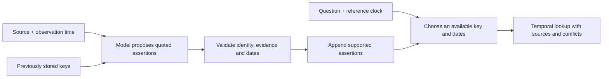

# Temporal assertions

Recall's experimental temporal store preserves dated source assertions and
answers explicit current or historical queries. Agents access it through
`temporal_remember` and `temporal_query` on the local MCP server.

For example, an assertion that a service used Azure from January can remain
available after a March assertion records its move to Cloudflare. A February
query can return Azure, while an April query returns Cloudflare.

## Recording evidence

Each assertion requires a repository, stable source assertion `event_id`,
subject, predicate, string value, `valid_from`, `observed_at`, and original
evidence text. Optional fields include an exclusive `valid_to`, source label,
confidence, and `supersedes_id`.

```json
{
  "repo": "example/service",
  "event_id": "session-12:hosting-change",
  "subject": "production",
  "predicate": "hosting_provider",
  "value": "Cloudflare",
  "valid_from": "2026-03-01",
  "observed_at": "2026-03-03",
  "evidence": "We moved production from Azure to Cloudflare on March 1.",
  "supersedes_id": "<id returned for the earlier Azure assertion>"
}
```

Source assertions are evidence data. Capturing one does not verify its truth,
authorize an action, or promote it into an active instruction. The ordinary
correction compiler and lifecycle hooks continue to handle durable coding rules.

The public temporal API appends assertions without rewriting earlier text.
Replaying the same repository and event id with the same normalized payload
returns the existing assertion. A different payload for that event id is an
error; a correction needs its own event id.

Subject and predicate matching normalizes case and whitespace. Repository
matching remains explicit and isolated. Dates accept real `YYYY-MM-DD` values
or ISO timestamps with a timezone, and normalize to UTC. Date-only values mean
midnight UTC. UTC normalization must remain within years 0000–9999.

## Querying time

```json
{
  "repo": "example/service",
  "subject": "production",
  "predicate": "hosting_provider",
  "as_of": "2026-02-15",
  "observed_before": "2026-04-01",
  "mode": "snapshot"
}
```

| Field | Meaning |
| --- | --- |
| `as_of` | The effective time being asked about. |
| `observed_before` | The latest source observation the query may use. |
| `mode: snapshot` | Resolve the assertions applicable at those two times. |
| `mode: history` | Return source-visible assertions, including replaced, expired, and future-effective ones. |

Both query times default to the same current instant. `observed_before` refers
to the supplied source observation time, not the database ingestion time.
`recorded_at` separately records the server's write time. These fields do not
authenticate a source's chronology.

Validity uses `[valid_from, valid_to)`. An explicit successor retires its
predecessor from the successor's effective start, once that successor is visible
at the observation cutoff. A planned future replacement does not retire the
current assertion early. An expired replacement does not resurrect its
predecessor.

A future-effective assertion can describe a plan. Temporal selection returns
what the sources assert; it does not verify that a scheduled change happened.
Automatic intake will need to preserve that distinction.

Independent overlapping assertions with different values remain a conflict.
The query returns the alternatives with `conflict: true`; confidence does not
silently decide which is true. Snapshot conflict detection happens before the
result limit. `matched_count` and `truncated` expose incomplete result pages.
The result limit defaults to 20 and accepts integers from 1 through 100.
In history mode, `conflict` is false because the response is an evidence history,
not a resolved snapshot.

## Current boundaries

This first version requires explicit subjects, predicates, dates, and replacement
links. It does not extract them automatically from conversation or parse
natural-language questions. It provides temporal selection for one
repository/subject/predicate at a time, rather than general graph SQL,
aggregation, or arbitrary multi-hop reasoning.

Temporal assertions live in a separate local table. They do not enter automatic
instruction injection or the existing Recall Cloud sync format. The usual
whole-store backup and data purge include them. They need an explicit retention
and portability design before broader product integration.

## Experimental UMP structured capture

`src/temporal/ump.ts` provides explicitly invoked
`captureUmpTemporalRecord` and `queryUmpTemporalRecords` functions. This pilot
uses the existing UMP draft format and a narrow application profile,
`body.structured.profile: "recall.temporal.v1"`. It does not change the UMP
standard. The frozen first pilot used SDK 0.1.0; the current checkout consumes
UMP SDK 1.0.2 from its exact GitHub release archive and lockfile integrity.
Registry publication was rejected by npm authentication, so the dependency
explicitly uses the release asset instead of an unavailable registry version.

```text
Trusted structured source + agent-produced UMP draft
              ↓ validate scope, source identity and supported fields
Frozen v3 grounding and temporal validation
              ↓
Private temporal namespace for the owner and project
              ↓ explicit structured query
Source assertions, dates, evidence and conflicts
```

The draft supplies `subject`, `predicate`, `value`, an exact `quote`,
`time_basis`, and an explicit nullable `supersedes_event_id` in its structured
body. `body.text` must equal the quote. Standard UMP fields carry the private
owner/project scope, observation time, validity interval and source reference.
The caller separately supplies the trusted source text, source event identity,
observation time and any speaker spans. Model-produced fields do not establish
speaker identity or authenticate the owner.

The bridge accepts semantic or identity drafts with explicit `time.observed`,
`time.valid_from` and nullable `time.valid_to`. An observed-time assertion must
use the source's observation time as its effective start. Explicit dates,
ownership, uncertainty and replacements remain subject to v3 validation and
declared predicate policies. Source replay must not change the supported
assertion or its evidence.

The profile rejects server-managed IDs, lifecycle, consent, integrity and
relationship fields. It also rejects extra fields rather than silently dropping
policy or provenance. It is a supported assertion mapping, not lossless storage
of arbitrary UMP records. Corrections use a new source event and an explicit
predecessor; ordinary UMP `revise` and `forget` are not implemented by this
bridge.

Queries use a namespace derived from the trusted owner and project. Namespace
separation is not authentication; a network-facing caller must authenticate
those inputs. These records do not enter ordinary memories, embeddings,
instruction injection, the existing `recall ump` server or Cloud sync.

The [UMP pilot protocol](../benchmark/TEMPORAL-UMP-PROTOCOL.md) defines fresh
synthetic capture calls, a matched validator control and a raw-source control.
It deliberately leaves automatic capture, natural question parsing, full UMP
lifecycle and Cloud integration outside the experiment.
The [completed UMP pilot](../benchmark/TEMPORAL-UMP-RESULTS.md) scored 27/34
structured lookups against 29/34 for matched v3. UMP capture stored four future
plans despite the state-only contract and reached 80% assertion precision and
66.7% recall. The candidate failed its adoption gates. It remains a development
prototype; passing structural validation does not certify semantic capture.

The separate `intake-v4.ts` and `ump-v2.ts` candidates retain the earlier
implementations for reproducibility. The new bridge emits UMP 1.0 drafts,
normalizes supported legacy input and uses a separate owner/project namespace.
Its capture validator adds narrow first-person perfect-tense grounding,
state-only future-plan refusal, and scoped support for explicit replacement
evidence across adjacent sentences. The structured low-level store continues
to permit explicit future-effective source assertions.

The [post-fix synthetic protocol](../benchmark/TEMPORAL-UMP-V2-PROTOCOL.md)
reruns all 24 development worlds. The
[public rerun protocol](../benchmark/TEMPORAL-V4-REAL-PROTOCOL.md) reruns the
same exposed 434 public question IDs using fresh capture, query, answer and
grading calls. Neither protocol makes these repeated examples a new holdout.
The previous reports and archived sources remain unchanged.
The [v4 results](../benchmark/TEMPORAL-V4-RESULTS.md) record the UMP release,
passing code gates and complete synthetic runs. After the first complete public
attempt suffered a provider outage, a separate complete recovery repetition
scored 168/434 for both temporal v4 and shared raw, versus 179/434 for full raw.
The one actual augmentation added no accuracy gain. Capture still stores some
source-supported events as continuing states, and request/schema failures
affected 51.15% of cases. Automatic capture and Cloud integration remain
disabled; SDK validity fixes do not establish semantic extraction quality.

## Reproducing the comparison

The local harness compares three representations of identical hand-structured
source assertions:

1. The existing Recall instruction compiler, using its default selection and
   context budget.
2. The temporal snapshot tool, given explicit query fields.
3. A source-history control.

```bash
npx tsx benchmark/temporal.ts --out /tmp/recall-temporal-smoke.json
```

The default run makes no model calls. It reports evidence coverage and context
size, while leaving answer accuracy unmeasured. An optional provider run uses
one answering model and the same answer format across all three arms:

```bash
npx tsx benchmark/temporal.ts \
  --provider azure-openai --limit 24 \
  --out /tmp/recall-temporal-qa.json
```

The provider uses Recall's existing configured credentials. Output distinguishes
exact answer accuracy, exact evidence attribution, request errors, latency, and
estimated context size. Failed or malformed model answers count as failures.
The three arms run concurrently for each question, with at most three answer
requests in progress and the same 512-token output limit. Questions run in their
fixed fixture order.
These synthetic fixtures test a small capability slice. Extraction, question
parsing, ordinary conversational capture, and long-term agent compliance remain
outside this experiment.
The actual SessionStart hook uses tighter limits (three memory lines and a
500-token budget) than this default-compiler comparison. Its reported compiler
score is therefore not a measurement of exact lifecycle delivery.

The [expanded evaluation protocol](../benchmark/TEMPORAL-EXPANDED-PROTOCOL.md)
defines fresh synthetic scenarios, repeated runs, a stronger scoped-history
control, and a separate fixed-schema extraction/query-parsing probe.
`benchmark/temporal-expanded.ts` and `benchmark/temporal-intake.ts` expose those
evaluations; both skip model calls when no provider is supplied. These tools
evaluate candidate integration paths and do not connect automatic intake to
the running memory system.
The [completed expanded report](../benchmark/TEMPORAL-EXPANDED-RESULTS.md)
records the measured gains and the integration hurdles that remain unmet.

The later [integration rehearsal protocol](../benchmark/TEMPORAL-CATEGORIES-PROTOCOL.md)
extends coverage to all ordinary memory types, source-language routing
boundaries, a type/source/scope/status coexistence matrix, backup recovery, and
sampled public conversations. It evaluates proposed components offline.
Passing a structured-store test does not certify automatic capture, lifecycle
delivery, retention, privacy, or Cloud synchronization.
The [rehearsal results](../benchmark/TEMPORAL-CATEGORIES-RESULTS.md) show correct
structured lookup and unchanged ordinary-memory selection, but automatic
source-language capture still fails the integration hurdles.

## Experimental language adapter

`src/temporal/intake.ts` adds explicitly invoked development helpers over the
existing store. `captureTemporalSource` accepts source text, its repository,
stable source event ID and observation timestamp. A caller supplies a model
callback and optional predicate policies. `queryTemporalLanguage` accepts a
question and an explicit reference clock.



Existing key IDs preserve entity/property identity across later sources.
Independent conflicting and corroborating reports remain separate evidence.
An explicit replacement requires a visible predecessor and source support.
Present-state assertions without a known start can establish support from the
observation instant; they do not establish earlier history. Invalid or
zero-length state intervals are rejected.

The language adapter is separate from the structured MCP tools and is not wired
into lifecycle hooks, normal queries, promotion, or Cloud synchronization.
Its model callback is provided by the caller; it does not configure a provider
or grant authority to source text. The
[v2 protocol](../benchmark/TEMPORAL-V2-PROTOCOL.md) defines development and
held-out validation for this candidate. Earlier benchmark reports remain
unchanged.
The [v2 results](../benchmark/TEMPORAL-V2-RESULTS.md) report exact capture and
supported lookup on a small holdout, explain the casing effect in the comparison,
and record a separate conflict/correction probe.

The [larger public-conversation protocol](../benchmark/TEMPORAL-REAL-PROTOCOL.md)
extends the comparison to additional public questions with semantic scoring and
a full-budget history control. It evaluates retrieval-time augmentation over
fresh lexical retrieval. It does not certify full-history automatic ingestion,
the deployed hybrid retrieval configuration or Recall Cloud.
The [completed comparison](../benchmark/TEMPORAL-REAL-RESULTS.md) found identical
semantic scores to the shared raw control on 434 questions, with only one
actual augmentation. The full-budget raw control scored higher, so this
candidate remains experimental.

The separate `src/temporal/intake-v3.ts` candidate corrects tested grounding,
uncertainty-scope, date-association and replay-identity defects. Its capture
input optionally accepts `speaker_spans` with integer `[start, end)` offsets,
`role: "user" | "assistant"` and a canonical `subject`. Callers must derive
these spans from trusted structured messages; text labels do not establish
speaker identity. Spans must be ordered, nonoverlapping and within the source,
with at most 128 entries.

The v3 helper supports narrow direct first-person binding, with relation/value
ownership checks. Direct binding currently uses matching user spans; assistant
spans prevent false user attribution. Metadata-backed evidence uses a version-3 JSON receipt;
identical stored-source replay includes normalized metadata, and changed
metadata conflicts. Plain evidence keeps its original representation except
that ambiguous receipt-shaped raw text is refused. The complete receipt must
fit the existing 16,000-character evidence limit.

The [v3 diagnostic](../benchmark/TEMPORAL-V3-RESULTS.md) reproduces the original
capture outputs through both validators. Its unchanged 165/434 answer score
uses cached answers and is not a fresh end-to-end accuracy result.

The adapter currently handles simple English state assertions and declared
property policies. Events, uncertain aliases and unsupported language can defer.
Catalogs are bounded to 80 keys, 200 assertions and 16,000 serialized characters;
overflow does not silently select a partial history. Date-only values use UTC
midnight. Relative-date grounding supports a narrow documented vocabulary and
does not establish exact intraday times from words such as "today."
Source-quote validation reduces unsupported associations; it is not a proof of
arbitrary natural-language semantics. Complex statements still need review.

On a workstation with the existing DGX Qwen router configured, the optional
local adapter runs the same answer test through an ephemeral loopback forwarder:

```bash
dgx run -- npx tsx benchmark/temporal.ts \
  --provider qwen-local --qwen-reasoning none \
  --out /tmp/recall-temporal-qwen.json
```

This adapter requires `DGX_BASE_URL` from the forwarder and reads the existing
scoped token internally. `DGX_KEY_FILE` can select a different token file.
Credentials and raw provider error bodies are excluded from reports. Actual
token usage is reported; a missing dollar price remains unknown.
Omitting `--qwen-reasoning` uses the server's default. Keep reasoning mode the
same across every arm and report separate modes as separate experiments. A
reasoning model may consume its entire output budget before emitting an answer.

## APEX-MEM evidence

[APEX-MEM](https://arxiv.org/abs/2604.14362) reports 88.88% LOCOMO answer accuracy
and 86.2% LongMemEval answer accuracy. Its system includes event-grounded facts,
temporal validity, append-only history, entity resolution, hybrid search, and
an agent with read-only graph SQL. Recall's prototype implements a narrower
temporal assertion store.

On 18 October 2026, the paper and GitHub searches for its name, arXiv identifier,
and the Amazon Science organization did not locate an official runnable
implementation. Similarly named repositories were unrelated. The local report
therefore marks APEX-MEM `not_run`; its published results are a separate
protocol, not a head-to-head result.

Recall's existing LongMemEval retrieval hit rate is also separate from answer
accuracy. A proper comparison needs the same dataset version, extraction
inputs, answering model, available evidence, context/tool budgets, evaluator,
and accounting for ingestion and query cost. Historical questions must preserve
source dates; unknown answers and conflicting assertions must remain in the
evaluation.
